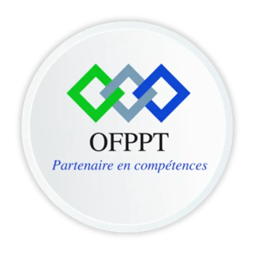

  
  

# Comprendre l’approche Agile et Scrum
### Application au projet : Blog des Lauréats

M5 · C.351 — Piloter un projet avec Scrum

<strong>Nom de l'apprenant :</strong> Ayoub Amaghouch 
<strong>Encadrant :</strong> ES-Sarraj Fouad

---

# 1. Pourquoi l’Agilité ?

**Cycle en V**
- Étapes successives
- Changements tardifs coûteux
- Validation souvent en fin de projet

**Agile**
- Travail par itérations courtes
- Retours réguliers
- Adaptation des priorités

**Objectif :** livrer de la valeur progressivement.

---

# 2. Les 4 valeurs Agile

1. Individus et interactions
2. Logiciel opérationnel
3. Collaboration avec le client
4. Adaptation au changement

Les processus, outils, documents et plans restent utiles : la priorité est donnée aux éléments de gauche.

---

# 3. Les 3 piliers de Scrum

| Pilier | Signification |
|---|---|
| Transparence | Rendre le travail visible |
| Inspection | Vérifier régulièrement |
| Adaptation | Ajuster et améliorer |

Ces piliers permettent à l’équipe de prendre des décisions à partir de faits.

---

# 4. Les 3 responsabilités Scrum

**Product Owner**
- Maximise la valeur
- Ordonne les priorités

**Scrum Master**
- Facilite Scrum
- Aide à lever les obstacles

**Développeurs**
- Réalisent le produit
- Livrent un incrément utilisable

---

# 5. Les 5 événements Scrum

1. **Sprint** — période d’un mois maximum
2. **Sprint Planning** — définir l’objectif et le plan
3. **Daily Scrum** — synchronisation quotidienne (15 min max)
4. **Sprint Review** — inspecter le résultat avec les parties prenantes
5. **Sprint Retrospective** — améliorer la façon de travailler

---

# 6. Incrément & Definition of Done

**Incrément :** résultat utilisable qui s’ajoute au produit.

**DoD :** critères communs pour considérer un travail terminé.

Exemples :
- Code intégré
- Tests réussis
- Fonctionnalité vérifiée

---

# 7. Exemple : Blog des Lauréats

**Objectif du premier Sprint :**

Permettre aux étudiants de consulter la liste des articles publiés et d’ouvrir un article.

- PO : priorise les fonctionnalités
- Scrum Master : facilite et débloque
- Développeurs : réalisent et testent

**Incrément :** parcours de consultation fonctionnel.

---

# 8. Conclusion

- Agile : avancer, écouter et s’adapter.
- Scrum : transparence, inspection et adaptation.
- Chaque Sprint produit un incrément utilisable.
- La DoD garantit une qualité partagée.

### Merci pour votre attention !
