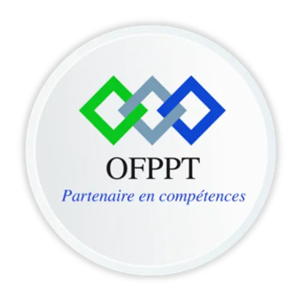
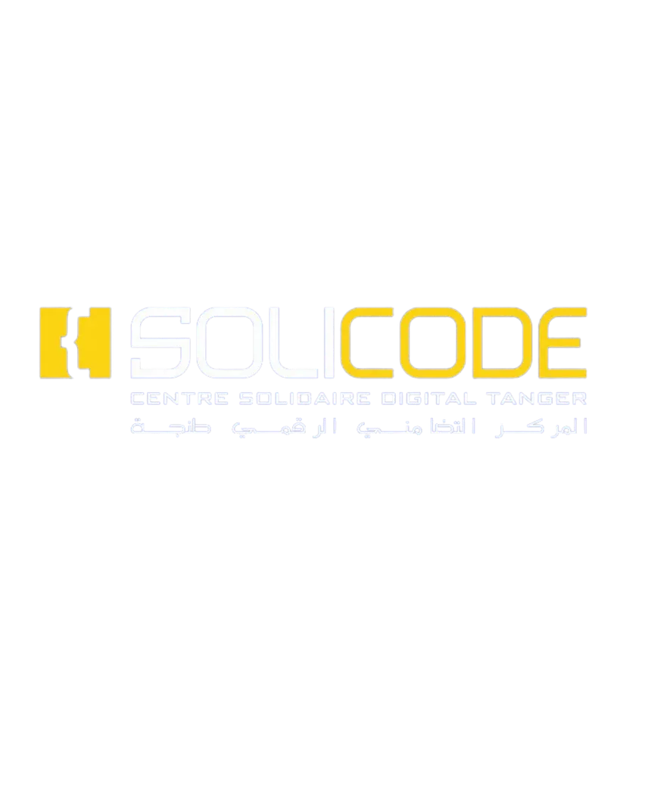

  
  

# Product Backlog

### Gestion de Véhicules V2

**M5 · C.351 — Collaborer au sein d'une équipe technique agile**

**Apprenant :** Ayoub Amaghouch  
**Encadrant :** ES-Sarraj Fouad

---

# 1. Le Product Backlog

Le Product Backlog est une liste évolutive de toutes les fonctionnalités, améliorations et corrections du produit.

Il est organisé et priorisé selon la valeur apportée aux utilisateurs.

**Responsabilité : Product Owner**

---

# 2. Les Story Points

Les Story Points permettent d'estimer l'effort relatif d'une User Story en prenant en compte :

- La complexité
- La quantité de travail
- L'incertitude

Contrairement aux heures, ils ne représentent pas une durée précise.

---

# 3. La suite de Fibonacci

Nous utilisons une échelle de Fibonacci pour estimer les User Stories :

## 1 · 2 · 3 · 5 · 8

Plus le nombre de points est élevé, plus l'effort estimé est important.

---

# 4. Priorisation MoSCoW

| Priorité | Signification |
|---|---|
| **Must** | Indispensable |
| **Should** | Important |
| **Could** | Facultatif |
| **Won't** | Non prévu pour cette version |

Cette méthode permet de sélectionner les fonctionnalités essentielles du MVP.

---

# 5. Product Backlog — Gestion de Véhicules V2

| User Story | Points | Priorité |
|---|---:|---|
| Ajouter un véhicule | 5 | Must |
| Consulter les véhicules | 2 | Must |
| Modifier un véhicule | 3 | Should |
| Supprimer un véhicule | 2 | Should |
| Rechercher un véhicule | 3 | Could |
| Dashboard & statistiques | 8 | Could |
| Export PDF/Excel | 5 | Won't |

---

# 6. Le MVP & Sprint 1

### Sprint Goal

> Permettre à l'utilisateur d'ajouter et de consulter les véhicules.

### User Stories sélectionnées

- US01 — Ajouter un véhicule : **5 points**
- US02 — Consulter les véhicules : **2 points**

### Total estimé : 7 Story Points

Les autres fonctionnalités seront développées progressivement dans les prochains Sprints.

---

# 7. Definition of Ready (DoR)

Une User Story est prête à être développée si :

- Le besoin est clair.
- La User Story est bien formulée.
- Les critères d'acceptation sont définis.
- L'estimation est réalisée.
- Les dépendances sont identifiées.

---

# 8. Definition of Done (DoD)

Une User Story est terminée si :

- La fonctionnalité est développée.
- Les tests sont réussis.
- Les critères d'acceptation sont validés.
- Aucun bug bloquant n'est présent.
- Le code est intégré.
- La fonctionnalité est opérationnelle.

---

# Conclusion

**Product Backlog → Estimation → Priorisation → Sprint Planning**

Nous organisons les fonctionnalités selon leur valeur, estimons l'effort en Story Points et définissons des critères de qualité avec la DoR et la DoD.

### Objectif : développer progressivement un produit utile et de qualité.

---

# Merci pour votre attention !

**Gestion de Véhicules V2**

M5 · C.351
