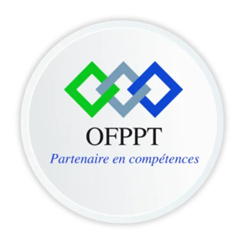
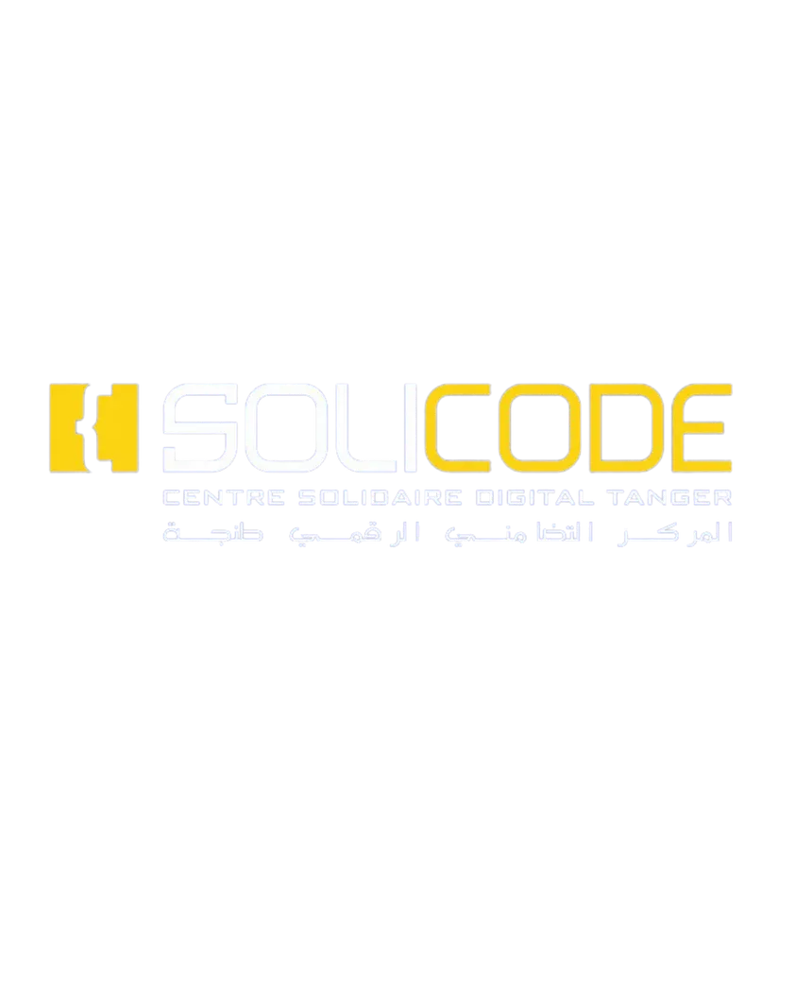

  
  

# Vision Produit & User Stories

### Gestion de Véhicules V2

**M5 · C.351 — Collaborer au sein d'une équipe technique agile**

**Apprenant :** Ayoub Amaghouch  
**Encadrant :** ES-Sarraj Fouad

---

# 1. La Vision Produit

La Vision Produit définit l'objectif principal de notre application.

> Permettre aux utilisateurs de gérer efficacement leurs véhicules à travers une application simple et intuitive, afin de centraliser les informations et gagner du temps.

---

# 2. Les Personas

### Persona 1 — Gestionnaire

- Gérer plusieurs véhicules
- Ajouter et modifier leurs informations
- Retrouver rapidement un véhicule

### Persona 2 — Utilisateur occasionnel

- Consulter les véhicules
- Rechercher un véhicule
- Utiliser une interface simple

---

# 3. Les User Stories

Une User Story décrit un besoin du point de vue de l'utilisateur.

### Structure

**En tant que** [utilisateur]  
**Je veux** [besoin]  
**Afin de** [objectif]

### Exemple

> En tant que gestionnaire, je veux ajouter un véhicule, afin de pouvoir enregistrer ses informations dans l'application.

---

# 4. Les Critères d'acceptation

Ils permettent de vérifier si une fonctionnalité est correctement réalisée.

### Exemple : Ajouter un véhicule

- Le formulaire est disponible.
- Les champs obligatoires sont vérifiés.
- Les données valides sont enregistrées.
- Un message de confirmation est affiché.

---

# 5. Les User Stories du projet

| User Story | Priorité |
|---|---|
| Ajouter un véhicule | Haute |
| Consulter les véhicules | Haute |
| Modifier un véhicule | Haute |
| Supprimer un véhicule | Haute |
| Rechercher un véhicule | Moyenne |

---

# 6. Le MVP

Le **Minimum Viable Product** représente la première version contenant les fonctionnalités essentielles.

### MVP de Gestion de Véhicules V2

- Ajouter
- Consulter
- Modifier
- Supprimer

### Évolutions futures

Recherche avancée, statistiques, export PDF/Excel et fonctionnalités supplémentaires.

---

# Conclusion

Notre démarche consiste à :

**Définir la vision → Identifier les utilisateurs → Exprimer les besoins → Définir les critères → Prioriser le MVP**

L'objectif est de développer une application qui répond réellement aux besoins des utilisateurs.

---

# Merci pour votre attention !

**Gestion de Véhicules V2**  
M5 · C.351
